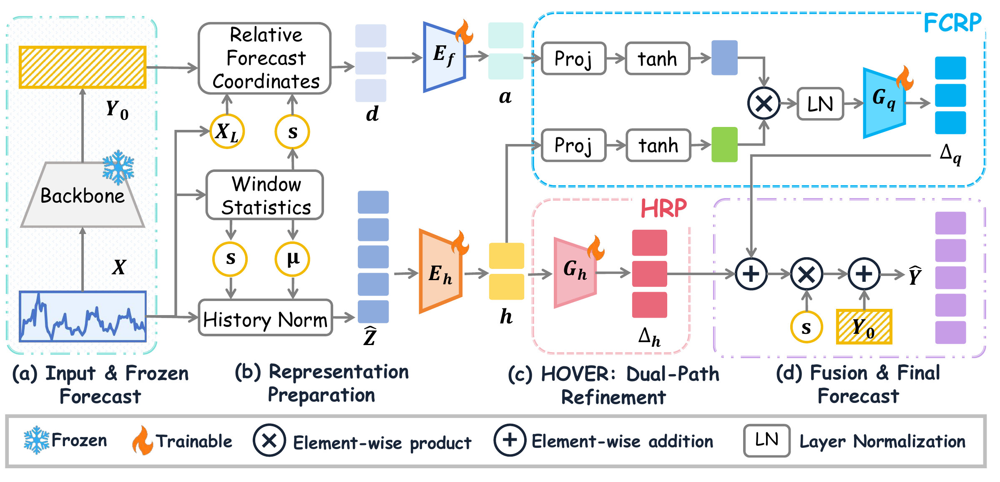
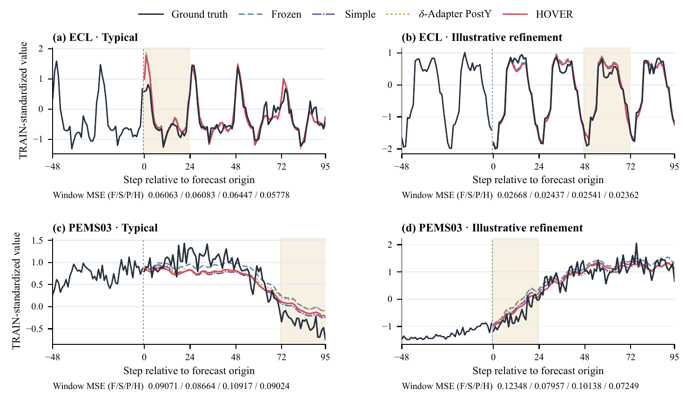

# HOVER

**History- and Output-Conditioned Variable-Shared Error Refinement for Frozen Time-Series Forecasters**

Tian Gan, Junshou Li, Shiming Fan, and Fan Zhang (corresponding author)
Shandong Technology and Business University, China

[Manuscript](paper/HOVER.pdf) · [Supplementary materials](supplementary/README.md) · [Paper results and reproduction](PAPER_RESULTS_INDEX.md)

## Abstract

Trained multivariate forecasters are often reused as existing prediction components. Organizing recent history and a model's own forecast trajectory to learn instance-specific residual corrections is a modeling challenge when reusing these predictive capabilities. We propose History- and Output-Conditioned Variable-Shared Error Refinement (HOVER), which learns direct historical and forecast-conditioned residuals from a shared historical representation. The latter represents the base forecast trajectory relative to the latest observation and modulates historical features through a low-dimensional multiplicative interaction. Both residuals are restored to the local scale and added to the frozen forecast, with parameters shared across variables. Matched-backbone and multi-horizon DEV experiments show that refinement reduces mean MSE in the evaluated settings. Capacity-matched and structural controls support the two-path organization, while prespecified independent held-out tests further reveal that the gains vary by task. The results suggest that structuring history and existing forecasts together offers a viable approach to error refinement while preserving the original prediction interface.

## Method

A shared encoder represents observed history for each variable. The history residual path (HRP) predicts a correction directly from this representation. The forecast-conditioned refinement path (FCRP) combines history features with the base trajectory relative to the last observation. Both paths share parameters across variables. Their residuals are rescaled and added to the frozen forecast.



Figure 2 shows the frozen forecaster, shared encoder, and two residual paths. See Section III of the [manuscript](paper/HOVER.pdf).

## Results

| Evaluation | Result |
| --- | --- |
| Table I · DEV · 12 datasets | OLinear + HOVER and paired NLinear + HOVER lead 15 and 3 of the 24 dataset–metric cells, respectively. |
| Table II · DEV · matched checkpoints | Mean MSE falls in all 15 evaluated backbone–dataset pairs. |
| Tables III–IV · DEV · structural controls | HOVER lowers mean MSE relative to Simple in five of six capacity-matched comparisons. Full HOVER has lower mean MSE than Only HRP in eleven of twelve tasks. History-surrogate outcomes vary by task and metric. |
| Table V · DEV · forecast horizons | Mean MSE falls in all 16 OLinear dataset–horizon settings. |
| Table VI · held-out TEST | Mean MSE falls in six of eight preselected OLinear and paired NLinear comparisons, with gains for both backbones on ECL, Solar, and PEMS03 and small increases on Exchange. |
| PostY · DEV · DLinear | HOVER lowers mean MSE relative to offline multiplicative PostY by 4.63% on ECL and 30.86% on PEMS03. |



Figure 7 shows selected DEV windows at seed 951. Each panel uses the same channel and origin for all four forecasts. Panel scores describe those windows. [Rebuild Figures 6 and 7](supplementary/trajectories/README.md)

## Quick start

Use Python 3.8.20 for the recorded environment and activate a fresh virtual environment.

```bash
python -m pip install -r requirements-cpu.txt
python -m pip install -e .
python -m hover demo --output outputs/demo.json
```

The CPU demo uses synthetic inputs. The [environment guide](docs/ENVIRONMENTS.md), [data acquisition](docs/DATA_ACQUISITION.md), and [external model guide](docs/EXTERNAL_MODEL_GUIDE.md) cover the paper setup.

## CPU tests

The base suite requires the Python dependencies from Quick start. It uses synthetic inputs and bundled reference records.

```bash
python -m unittest discover -s tests -p "test_science.py" -v
python supplementary/verify_scores.py
```

The optional integration suite requires the pinned LTSF-Linear and FITS
source trees in the default external directory or in the directory specified
by the HOVER_EXTERNAL_ROOT environment variable. Missing trees yield explicit
skips. Present trees must pass the pinned file identity checks. See the
[external model guide](docs/EXTERNAL_MODEL_GUIDE.md) for acquisition and registration.

```bash
python -m unittest discover -s tests -p "test_external.py" -v
```

## Reproduce the paper

| Paper item | Entry point |
| --- | --- |
| Table I · complete systems | `python -m hover run --stage A` |
| Tables II–III · matched backbones and capacity | `python -m hover run --stage Table2` |
| Table IV · structural controls | `python -m hover run --stage B` |
| Table V · horizons | `python -m hover run --stage C` |
| Table VI and PostY | [Evaluation records and protocols](supplementary/README.md) |

The commands in the table print a plan and return PLAN_ONLY. They enumerate
the requested records without fitting models. Add the execution flag to run the
resolved tasks with the pinned sources and prepared data. The following
single-record CUDA command was exercised in the documented ETTm1 seed-951
verification. Paths are relative to the repository root.

```bash
python -m hover run --stage A --dataset ETTm1 --horizon 96 --system NLINEAR_HOVER --seed 951 --data-root data/prepared --output outputs/reproduction --external-root external_models --device cuda:0 --threads 1 --execute
```

Use the prepared ETTm1 TRAIN/DEV cache, the pinned LTSF source tree, and the
CUDA environment described in the [environment guide](docs/ENVIRONMENTS.md).
The [single-seed verification record](manifests/GPU_single_seed_independent_acceptance.json)
states the tested scope. The [paper index](PAPER_RESULTS_INDEX.md) links
the figures and tables to their reference evidence.

[Rebuild Figures 6 and 7](supplementary/trajectories/README.md) from upstream
data and published forecasts, or rerun the six selected DEV windows with the
original reference checkpoints and pinned external sources. The bundle provides
checkpoint hashes. Acquire the checkpoint and Q files separately for inference.
The PostY training recipe and the complete DLinear TEST records are provided as
reference evidence. Standalone PostY training and full DLinear TEST evaluation
remain outside the released runner.

## Citation and license

Please cite the manuscript when using HOVER or link to this repository. [Software citation](CITATION.cff)

```bibtex
@unpublished{gan2026hover,
  title = {HOVER: History- and Output-Conditioned Variable-Shared Error Refinement for Frozen Time-Series Forecasters},
  author = {Gan, Tian and Li, Junshou and Fan, Shiming and Zhang, Fan},
  note = {Manuscript}
}
```

HOVER's own code is available under the [MIT License](LICENSE). External forecasters and PostY are obtained separately under their applicable terms. [External model registry](docs/EXTERNAL_MODEL_REGISTRY.md) · [Third-party notices](THIRD_PARTY_NOTICES.md)
